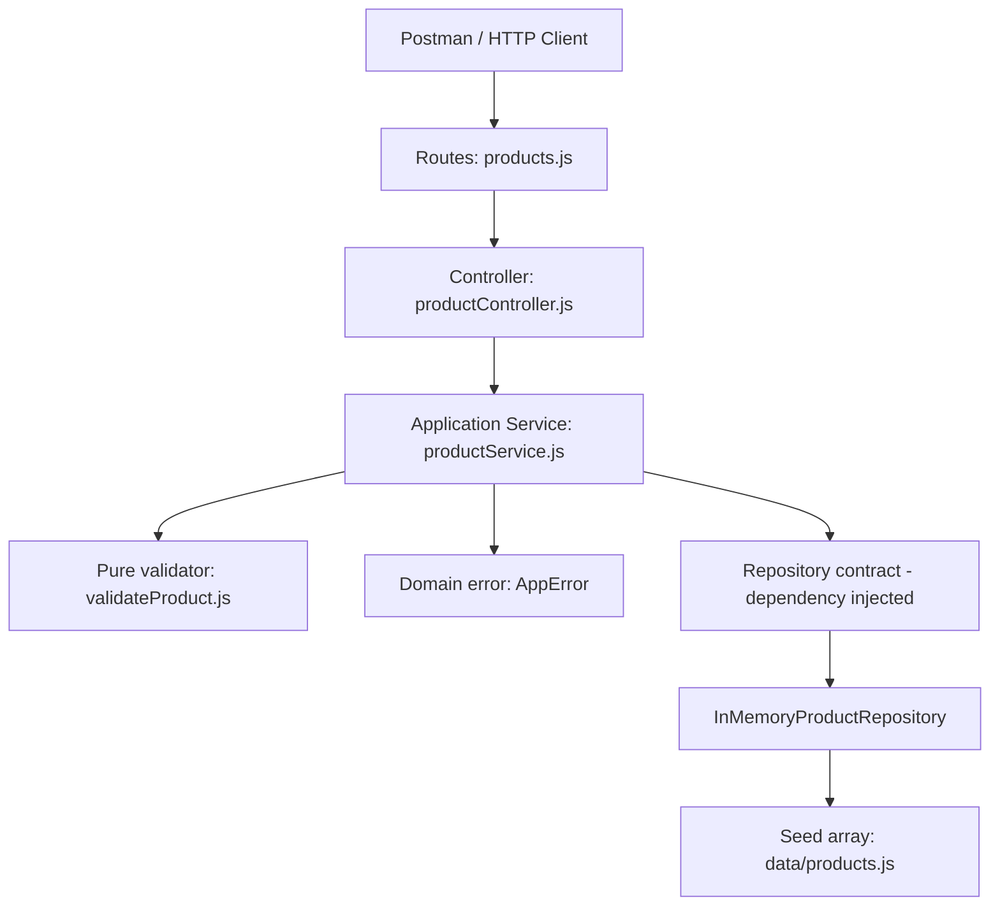

# Design Document — Product Catalog CRUD + PATCH

## Overview

API Katalog Produk adalah layanan backend berbasis RESTful API yang menyediakan fungsi Full CRUD untuk manajemen katalog produk digital. Layanan ini dibuat menggunakan Node.js (v18+) dan Express dengan arsitektur berlapis (Clean Architecture) sederhana yang memisahkan lapisan HTTP, logika bisnis, dan penyimpanan data tanpa menggunakan database eksternal.

Desain ini menggunakan in-memory repository sebagai media penyimpanan sementara yang di-seed dengan 9 data awal di mana semua manipulasi data terjadi dalam RAM dan terisolasi per instance aplikasi. Perubahan atau pembaruan kode diverifikasi menggunakan test suite bawaan node:test dan Postman Collection untuk menjamin integritas fungsionalitas API.
Dokumen ini mengacu pada requirements.md yang telah disetujui.

## Architecture

Arsitektur berlapis **terinspirasi Clean Architecture**, dengan pemisahan HTTP, use cases, dan akses data; sengaja sederhana untuk mini project.



**Dependency rule:** Router and controller depend on the service interface exposed by `createProductService`. Service depends only on a repository *contract* (`list`, `findById`, `insert`, `replace`, `remove`), pure validator, and framework-independent `AppError`, not on Express or the concrete repository. `src/app.js` is the composition root that wires dependencies together. This is not a claim of implementing every formal Clean Architecture ring/entity convention.

### Folder structure

```text
src/
  app.js                          # composition root, Express setup, startup
  routes/products.js              # URL/HTTP method map only
  controllers/productController.js # HTTP input/response and errors
  services/productService.js      # use cases, filtering, CRUD orchestration
  domain/errors.js                # typed application errors, no Express coupling
  repositories/inMemoryProductRepository.js # in-memory storage adapter
  data/products.js                # initial 9 product records
  utils/validateProduct.js        # pure validation helper
api-documentation/
  Product_Catalog_API_Full_CRUD.postman_collection.json
  PANDUAN_POSTMAN.md
test/productService.test.js        # built-in Node.js node:test suite
.kiro/specs/product-catalog-crud/
  requirements.md
  design.md
  tasks.md
```

## Components and Interfaces

### Component Responsibilities

| Component | Responsibility | Explicitly does NOT |
| --- | --- | --- |
| Express app | Configure JSON parser, compose repo → service → controller → router; handle malformed JSON | Apply catalog filters or mutate data |
| Product routes | Register GET, POST, PUT, PATCH, DELETE paths | Query/rewrite dataset |
| HTTP controller | Extract req data; call service; map `AppError` to JSON HTTP 400/404 | Filter products or calculate ID |
| Product service | Validate search/filter/sort; create, update, delete, enforce rules | Depend on `req`, `res`, or import Express |
| Repository | Own array and CRUD persistence interface | Decide HTTP statuses |
| Validator | Validate product fields without modifying input | Perform HTTP/network access |
| `AppError` | Describe BAD_REQUEST, VALIDATION, NOT_FOUND errors | Depend on Express |

### Repository contract

```js
{
  list(): Product[],
  findById(id: number): Product | null,
  insert(product: Product): Product,
  replace(id: number, product: Product): Product | null,
  remove(id: number): Product | null,
}
```

Repository is injected into `createProductService(repository)`; it copies incoming seed data using `structuredClone` and returns copies to prevent clients from mutating the store accidentally. Each `createApp()` creates isolated repository state. Node.js 18+ required for native `structuredClone` and `node:test`.

## Data Models

```json
{
  "id": 10,
  "name": "Jam Tangan Digital",
  "description": "Jam tangan digital dengan stopwatch",
  "category": "Electronics",
  "price": 250000,
  "image": "https://picsum.photos/seed/jam-tangan-digital/400/400",
  "variants": {
    "colorOrSize": ["Black", "Silver"],
    "quantity": 20
  }
}
```

`id` auto-generated via `max(existing id) + 1`, except empty dataset starts at 1. Currency IDR, represented as numeric amount (no formatted currency string). `price` must be a nonnegative numeric value, `image` syntactically valid HTTP/HTTPS URL (not checked for availability), `variants.colorOrSize` non-empty string array, `variants.quantity` nonnegative integer. The service disregards changes to `id` on update.

## API contracts

| Method | Path | Success | Errors | Description |
| --- | --- | --- | --- | --- |
| GET | `/api/products` | 200 `{data:[...],total:N}` | 400 `{message}` | Browse with optional query parameters |
| GET | `/api/products/:id` | 200 Product | 404 `{message}` | Detail |
| POST | `/api/products` | 201 Product | 400 `{message,errors:[...]}` | Create complete product |
| PUT | `/api/products/:id` | 200 Product | 400/404 | **Legacy compatible partial update** |
| PATCH | `/api/products/:id` | 200 Product | 400/404 | Partial update, including nested variants |
| DELETE | `/api/products/:id` | 200 `{message,data:Product}` | 404 `{message}` | Delete |

### GET list parameters

- `q`: substring match against `name` OR `description`, case-insensitive.
- `category`: case-insensitive exact match.
- `minPrice`, `maxPrice`: number parsed from text, finite, inclusive bounds; empty value ignored; min greater than max = 400.
- `sort`: `name_asc`, `name_desc`, `price_asc`, `price_desc`; invalid = 400.
- Each parameter must be a single string, not duplicate query arrays/objects; invalid = 400.
- Apply filters with AND semantics, then sort the matched results. Empty results = 200 `{data:[],total:0,message:"..."}`.

### PUT versus PATCH decision

The previously shipped `PUT /api/products/:id` **already performs partial update**, for compatibility with the existing Postman tests and original user workflow. Changing PUT to full replacement now would break established behavior. The new `PATCH` implements the same *merge semantics* through one shared service method:

- Only included top-level fields are changed; omitted ones stay unchanged.
- When `variants` is included, only supplied sub-fields change; missing ones stay unchanged.
- `id` is always preserved.
- Invalid bodies return 400; unknown IDs return 404.

**REST convention note:** PUT is usually defined as full-resource replacement and PATCH as partial modification. The current PUT partial behavior is a documented compatibility choice, not a general recommendation. A future breaking API version could introduce true replacement semantics for PUT with appropriate migration and tests.

### Create product sequence

```mermaid
sequenceDiagram
    participant Client
    participant Controller
    participant Service
    participant Validator
    participant Repository
    Client->>Controller: POST /api/products (JSON)
    Controller->>Service: create(body)
    Service->>Validator: validateProduct(body)
    alt invalid
      Validator-->>Service: errors[]
      Service-->>Controller: AppError VALIDATION
      Controller-->>Client: 400 {message,errors}
    else valid
      Service->>Repository: list() for next id; insert(product)
      Repository-->>Service: created Product
      Service-->>Controller: Product
      Controller-->>Client: 201 Product
    end
```

## Correctness Properties

Properti berikut adalah perilaku yang harus tetap benar pada tiap perubahan kode, bukan klaim bahwa pengujian berbasis properti (*property-based testing*) telah dijalankan. Referensi R mengacu ke `requirements.md`.

1. **Konsistensi daftar (R1, R8):** Pada setiap respons GET daftar yang berhasil, `total === data.length`; ketika tidak ada kecocokan, `data` kosong, `total` bernilai 0, dan terdapat pesan hasil kosong.
2. **Pencarian (R3):** Hasil pencarian hanya berisi produk dengan nama **atau** deskripsi yang memuat `q` tanpa membedakan kapital; menghapus `q` tidak mengubah filter lain yang aktif.
3. **Kombinasi filter (R4–R7):** Semua produk hasil harus memenuhi seluruh kriteria aktif (`q`, `category`, `minPrice`, `maxPrice`); batas harga bersifat inklusif.
4. **Sorting (R6–R7):** Mengubah `sort` hanya mengubah urutan hasil yang lolos filter, bukan anggota himpunan hasil, dan tidak memutasi urutan dataset yang disimpan.
5. **Validasi query (R5, R14):** Query parameter yang tidak valid menghasilkan HTTP 400, bukan crash; rentang `minPrice > maxPrice` ditolak.
6. **Identitas produk (R9, R10, R17):** POST menghasilkan ID baru yang unik; PUT/PATCH mempertahankan ID awal sekalipun body menyertakan `id`.
7. **Pembaruan parsial (R10, R17):** PUT dan PATCH mengubah hanya field yang dikirim. Saat `variants.quantity` dikirim tanpa `colorOrSize`, nilai `colorOrSize` sebelumnya tetap utuh, dan sebaliknya.
8. **Validasi tanpa mutasi (R12–R13, R17):** Input tidak valid menghasilkan HTTP 400 dengan `errors` dan tidak mengubah data yang tersimpan; `quantity` merupakan bilangan bulat nonnegatif dan `image` berformat HTTP/HTTPS.
9. **Siklus CRUD (R9–R11, R15):** Produk yang dibuat dapat diambil lewat GET; update terlihat pada GET berikutnya; produk yang dihapus menghasilkan 404 pada GET detail berikutnya.
10. **Isolasi penyimpanan (R15, R18):** Dua instance aplikasi tidak saling membagikan perubahan dataset; restart proses mengembalikan data awal yang ditentukan seed.

## Error Handling

| Service error code | HTTP response |
| --- | --- |
| `BAD_REQUEST` | 400 `{message}` |
| `VALIDATION` | 400 `{message:"Data produk tidak valid",errors:[...]}` |
| `NOT_FOUND` | 404 `{message}` |
| Invalid JSON syntax in Express parser | 400 `{message:"Format JSON tidak valid"}` |

Unexpected exceptions are not reclassified as known validation failures; normal Express error handling applies. API uses `application/json` responses. There is no authentication in this exercise.

## Persistence and limitations

The repository keeps changes in RAM during the server process. Restarting the app restores nine seed products. It is not concurrent/multi-instance safe and intentionally has no database or transaction mechanism. Images are placeholder URLs and not fetched server-side. No frontend or production deployment.

## Testing Strategy

- **Unit and controller-adapter tests**: `node --test test/*.test.js` via `npm test` (requires Node.js 18+). Tests cover search, filter, sort, responses, errors, create, PUT, PATCH nested update, delete, repository isolation.
- **Actual HTTP API and collection tests**: run `npm ci`, `npm run dev` locally; import Postman Collection and execute GET groups plus sequential CRUD Mutation Flow; record HTTP status and JSON response.
- **Regression**: baseline GET/POST/PUT/DELETE request/response shapes and original query keys are unchanged. PATCH is additive.
- **Verification boundary**: unit/controller tests can run without Express installed; HTTP-level tests must be run against the user's local Express server before claiming end-to-end verification.

## Requirements traceability

| Requirements | Design elements |
| --- | --- |
| R1–R8, R14 | Service list/getById; list query validation and sorting; HTTP controller |
| R9, R12–R13 | Validator + service create + repository insert |
| R10, R12–R13 | Service update + repository replace; PUT controller |
| R11 | Service remove + repository remove |
| R15 | In-memory repository, isolated per-app data |
| R16 | Postman Collection and guide |
| R17 | PATCH route/controller; shared partial update use case |
| R18 | Dependency injection, controller/service/repository layering, unit tests |
