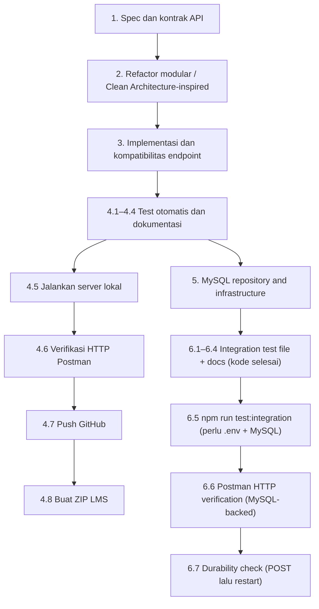

# Implementation Plan — Product Catalog CRUD + PATCH + MySQL

## Overview

Dokumen `tasks.md` ini adalah **checklist implementasi dan verifikasi retrospektif**. Penanda `[x]` menunjukkan bagian yang sudah diimplementasikan dan diverifikasi melalui kode atau `npm test`; `[ ]` menunjukkan aktivitas yang masih perlu dilakukan secara manual oleh pengguna (pengujian HTTP live, GitHub push, pengumpulan).

Rujukan `R1`–`R21` menunjuk ke `.kiro/specs/product-catalog-crud/requirements.md`. Grup 1–4 mencakup implementasi CRUD in-memory awal. Grup 5–6 mencakup migrasi MySQL (R19–R21).

## Tasks

### 1. Spec dan kontrak API

- [x] 1.1 Audit PRD asli dan persyaratan tambahan assignment (CRUD, dokumentasi). **R1–R16**
- [x] 1.2 Susun `requirements.md` termasuk acceptance criteria dari implementasi yang terverifikasi. **R1–R16**
- [x] 1.3 Tambahkan perubahan kebutuhan untuk `PATCH` dan pemisahan arsitektur. **R17–R18**
- [x] 1.4 Susun `design.md` berisi arsitektur berlapis, kontrak API, error mapping, dan alur data. **R1–R18**

### 2. Refactor modular / Clean Architecture-inspired

- [x] 2.1 Jadikan `src/app.js` composition root dan dukung `createApp` untuk test isolation. **R15, R18**
- [x] 2.2 Pertahankan router hanya sebagai pemetaan HTTP method dan path. **R18**
- [x] 2.3 Implementasikan `productController` untuk menerjemahkan HTTP request/response. **R18**
- [x] 2.4 Pindahkan search/filter/sort dan create/update/delete use cases ke `productService`. **R1–R11, R18**
- [x] 2.5 Buat in-memory repository dengan kontrak terpisah dan salinan aman. **R9–R11, R15, R18**
- [x] 2.6 Gunakan validasi produk bersama dan typed `AppError` framework-independent. **R12–R14, R18**

### 3. Implementasi dan kompatibilitas endpoint

- [x] 3.1 Pertahankan GET list (`q`, `category`, `minPrice`, `maxPrice`, `sort`) dan GET detail. **R1–R8, R14**
- [x] 3.2 Pertahankan POST validasi lengkap dan auto-generated ID. **R9, R12–R13**
- [x] 3.3 Pertahankan PUT partial-update lama dan merge nested variants. **R10, R12–R13**
- [x] 3.4 Tambahkan `PATCH /api/products/:id` memakai use case partial-update bersama PUT. **R17**
- [x] 3.5 Pertahankan DELETE dan respons item yang dihapus. **R11**
- [x] 3.6 Pastikan error 400/404, JSON parsing error 400, dan persistensi in-memory. **R13–R15, R17**

### 4. Testing, documentation, submission

- [x] 4.1 Tambahkan Node.js built-in tests untuk use cases, controller mapping, repository isolation, dan PATCH. **R1–R18**
- [x] 4.2 Jalankan `npm test` untuk regression tests di lingkungan eksekusi yang tersedia. **R1–R18**
- [x] 4.3 Perbarui Postman Collection: request PATCH sukses, invalid, not found, dan alur CRUD berurutan. **R16–R17**
- [x] 4.4 Perbarui README dan panduan Postman agar sesuai dengan PATCH dan struktur baru. **R16–R18**
- [ ] 4.5 Jalankan `npm ci` atau `npm install` dan `npm run dev` di komputer lokal pengguna. **R1–R18**
- [ ] 4.6 Jalankan **HTTP nyata** Postman Collection Runner; simpan hasil GET, POST, PUT, PATCH, DELETE, 400, dan 404. **R1–R17**
- [ ] 4.7 Push versi revisi ke repository GitHub, termasuk `.kiro/specs`, tes, dan dokumentasi; pastikan `.gitignore` tidak mengecualikan Specs. **R16, R18**
- [ ] 4.8 Buat ZIP penyerahan LMS tanpa `node_modules` dan `.env`. **Submission**

### 5. MySQL Repository and Infrastructure

- [x] 5.1 Install `mysql2` and `dotenv` as production dependencies via npm. **R19, R21** `package.json`
- [x] 5.2 Create `.env.example` with placeholder values for `DB_HOST`, `DB_PORT`, `DB_USER`, `DB_PASSWORD`, `DB_NAME`; do not create `.env` itself. **R21** `.env.example`
- [x] 5.3 Add `.env` to `.gitignore` if not already present. **R21** `.gitignore`
- [x] 5.4 Create `database/schema.sql` with `CREATE TABLE IF NOT EXISTS` for `products` and `product_variant_options` matching the existing database schema. **R21** `database/schema.sql`
- [x] 5.5 Create `src/db/pool.js` exporting a singleton `mysql2/promise` connection pool reading `DB_HOST`, `DB_PORT` (default 3306), `DB_USER`, `DB_PASSWORD`, `DB_NAME` from `process.env`. **R19** `src/db/pool.js`
- [x] 5.6 Create `src/repositories/mysqlProductRepository.js` implementing the repository contract (`list`, `findById`, `insert`, `replace`, `remove`) as async functions; GROUP_CONCAT LEFT JOIN for reads; BEGIN/COMMIT/ROLLBACK transactions for insert and replace; ON DELETE CASCADE for remove; cast DECIMAL price and BIGINT id to JS `Number`. **R19, R20** `src/repositories/mysqlProductRepository.js`
- [x] 5.7 Update `src/services/productService.js` to make all methods async and `await` repository calls; validation logic and error codes unchanged. **R19** `src/services/productService.js`
- [x] 5.8 Update `src/controllers/productController.js` to make `respond` async, `await` service calls, and return HTTP 500 for unexpected non-AppError exceptions. **R19** `src/controllers/productController.js`
- [x] 5.9 Update `src/app.js` to load dotenv, add startup connectivity check, log safe error and exit 1 on DB failure, wire MySQL repository when `NODE_ENV !== 'test'`, keep in-memory for `NODE_ENV === 'test'`. **R19, R21** `src/app.js`

### 6. Integration Tests, Documentation, and Verification

- [x] 6.1 Create `test/mysqlRepository.integration.test.js`: insert, findById, replace, remove against real DB; cleanup only test data; never delete 9 seed products. **R19, R20** `test/mysqlRepository.integration.test.js`
- [x] 6.2 Add `test:integration` npm script running only `test/*.integration.test.js`; `npm test` continues to run unit tests only. **R19** `package.json`
- [x] 6.3 Run `npm test` — all 33 unit tests pass without a database connection. **R18, R19** `test/productService.test.js`
- [x] 6.4 Update `README.md` with MySQL prerequisites, database setup steps (schema.sql + seed), `.env` creation, and persistence behavior. **R21** `README.md`
- [ ] 6.5 Run `npm run test:integration` against a live MySQL instance; confirm insert/find/replace/remove and that the 9 seed products remain. **R19, R20** `test/mysqlRepository.integration.test.js`
- [ ] 6.6 Run Postman Collection Runner against the MySQL-backed server (`npm run dev`); verify all existing request scenarios pass. **R1–R17, R19** `api-documentation/`
- [ ] 6.7 Manually verify that data created via POST survives a server restart, confirming MySQL durability. **R15, R19**

## Task Dependency Graph

**Definisi waves untuk eksekusi tugas Kiro** (JSON berikut menjadi acuan machine-readable; diagram Mermaid di bawah hanya visualisasi):

```json
{
  "waves": [
    { "id": 0, "tasks": ["1.1"] },
    { "id": 1, "tasks": ["1.2"] },
    { "id": 2, "tasks": ["1.3"] },
    { "id": 3, "tasks": ["1.4"] },
    { "id": 4, "tasks": ["2.5", "2.6"] },
    { "id": 5, "tasks": ["2.4"] },
    { "id": 6, "tasks": ["2.3"] },
    { "id": 7, "tasks": ["2.2"] },
    { "id": 8, "tasks": ["2.1"] },
    { "id": 9, "tasks": ["3.1"] },
    { "id": 10, "tasks": ["3.2"] },
    { "id": 11, "tasks": ["3.3"] },
    { "id": 12, "tasks": ["3.4"] },
    { "id": 13, "tasks": ["3.5"] },
    { "id": 14, "tasks": ["3.6"] },
    { "id": 15, "tasks": ["4.1", "4.3"] },
    { "id": 16, "tasks": ["4.2", "4.4"] },
    { "id": 17, "tasks": ["4.5"] },
    { "id": 18, "tasks": ["4.6"] },
    { "id": 19, "tasks": ["4.7"] },
    { "id": 20, "tasks": ["4.8"] },
    { "id": 21, "tasks": ["5.1", "5.2", "5.3", "5.4"] },
    { "id": 22, "tasks": ["5.5"] },
    { "id": 23, "tasks": ["5.6"] },
    { "id": 24, "tasks": ["5.7"] },
    { "id": 25, "tasks": ["5.8"] },
    { "id": 26, "tasks": ["5.9"] },
    { "id": 27, "tasks": ["6.1", "6.4"] },
    { "id": 28, "tasks": ["6.2", "6.3"] },
    { "id": 29, "tasks": ["6.5"] },
    { "id": 30, "tasks": ["6.6"] },
    { "id": 31, "tasks": ["6.7"] }
  ]
}
```

Diagram berikut menunjukkan **ketergantungan logis**. Nomor mengacu ke kelompok tugas di atas.



**Ketergantungan penting:**
- 5.1–5.9 selesai di kode; verifikasi runtime memerlukan `.env` yang valid.
- 6.5–6.7 memerlukan MySQL live — tidak bisa diverifikasi tanpa koneksi database aktif.
- Postman CRUD flow (6.6) harus dijalankan terhadap server yang sedang berjalan; dataset tidak direset otomatis saat restart.

## Notes

- Status `[x]` pada grup 5 dan 6.1–6.4 berdasarkan verifikasi kode dan `npm test` (33/33 lulus).
- 6.5–6.7 belum dieksekusi karena memerlukan koneksi MySQL live dan belum ada `.env` saat implementasi.
- Restart server MySQL **tidak** mengembalikan data ke kondisi awal (berbeda dari in-memory).
- PUT yang sudah ada sengaja tetap menerima partial update untuk kompatibilitas; PATCH adalah endpoint baru.
- Jangan commit `node_modules`, `.env`, ataupun folder `.git`; folder `.kiro/specs/` perlu ikut disertakan.

### Acceptance Gate Sebelum Dikumpulkan

- [x] `npm test` — 33/33 unit tests lulus tanpa database.
- [ ] `npm run test:integration` lulus terhadap MySQL lokal.
- [ ] Server `npm run dev` berhasil start dan terhubung ke MySQL.
- [ ] Postman Collection Runner lulus semua folder (GET, search, filter, sort, combined, CRUD).
- [ ] Data POST tetap ada setelah restart server (konfirmasi MySQL durability).
- [ ] PUT lama dan PATCH keduanya bekerja (terlihat dari Postman).
- [ ] `.env` tidak ada dalam commit atau ZIP pengumpulan.
- [ ] `requirements.md`, `design.md`, `tasks.md` hadir dan sesuai implementasi.