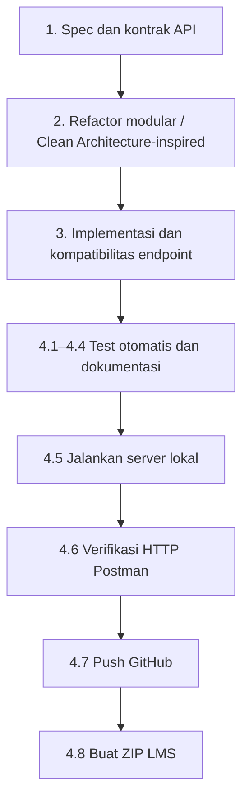

# Implementation Plan — Product Catalog CRUD + PATCH

## Overview

Dokumen `tasks.md` ini adalah **checklist implementasi dan verifikasi retrospektif** berdasarkan source code yang telah dibuat dan refactor/PATCH tambahan. Ini **bukan** bukti bahwa tugas awal dieksekusi oleh Kiro Spec Agent satu per satu. Penanda `[x]` menunjukkan bagian yang sudah diimplementasikan atau diuji sesuai bukti yang tersedia; `[ ]` menunjukkan aktivitas lokal dan pengumpulan yang masih perlu dilakukan.

Rujukan `R1` sampai `R18` menunjuk ke `.kiro/specs/product-catalog-crud/requirements.md`. Pengembangan tetap menggunakan in-memory array dan tidak menambah database, autentikasi, atau frontend.

## Tasks

### 1. Spec dan kontrak API

- [x] 1.1 Audit PRD asli dan persyaratan tambahan assignment (CRUD, dokumentasi). **R1–R16**
- [x] 1.2 Susun `requirements.md` termasuk acceptance criteria dari implementasi yang terverifikasi. **R1–R16**
- [x] 1.3 Tambahkan perubahan kebutuhan untuk `PATCH` dan pemisahan arsitektur. **R17–R18**
- [x] 1.4 Susun `design.md` berisi arsitektur berlapis, kontrak API, error mapping, dan alur data. **R1–R18**

### 2. Refactor modular / Clean Architecture-inspired

- [x] 2.1 Jadikan `src/app.js` composition root dan dukung `createApp` untuk test isolation. **R15, R18**
- [x] 2.2 Pertahankan router hanya sebagai pemetaan HTTP method dan path. **R18**
- [x] 2.3 Implementasikan `productController` untuk menerjemahkan HTTP request/response. **R18**
- [x] 2.4 Pindahkan search/filter/sort dan create/update/delete use cases ke `productService`. **R1–R11, R18**
- [x] 2.5 Buat in-memory repository dengan kontrak terpisah dan salinan aman. **R9–R11, R15, R18**
- [x] 2.6 Gunakan validasi produk bersama dan typed `AppError` framework-independent. **R12–R14, R18**

### 3. Implementasi dan kompatibilitas endpoint

- [x] 3.1 Pertahankan GET list (`q`, `category`, `minPrice`, `maxPrice`, `sort`) dan GET detail. **R1–R8, R14**
- [x] 3.2 Pertahankan POST validasi lengkap dan auto-generated ID. **R9, R12–R13**
- [x] 3.3 Pertahankan PUT partial-update lama dan merge nested variants. **R10, R12–R13**
- [x] 3.4 Tambahkan `PATCH /api/products/:id` memakai use case partial-update bersama PUT. **R17**
- [x] 3.5 Pertahankan DELETE dan respons item yang dihapus. **R11**
- [x] 3.6 Pastikan error 400/404, JSON parsing error 400, dan persistensi in-memory. **R13–R15, R17**

### 4. Testing, documentation, submission

- [x] 4.1 Tambahkan Node.js built-in tests untuk use cases, controller mapping, repository isolation, dan PATCH. **R1–R18**
- [x] 4.2 Jalankan `npm test` untuk regression tests di lingkungan eksekusi yang tersedia. **R1–R18**
- [x] 4.3 Perbarui Postman Collection: request PATCH sukses, invalid, not found, dan alur CRUD berurutan. **R16–R17**
- [x] 4.4 Perbarui README dan panduan Postman agar sesuai dengan PATCH dan struktur baru. **R16–R18**
- [ ] 4.5 Jalankan `npm ci` atau `npm install` dan `npm run dev` di komputer lokal pengguna. **R1–R18**
- [ ] 4.6 Jalankan **HTTP nyata** Postman Collection Runner; simpan hasil GET, POST, PUT, PATCH, DELETE, 400, dan 404. **R1–R17**
- [ ] 4.7 Push versi revisi ke repository GitHub, termasuk `.kiro/specs`, tes, dan dokumentasi; pastikan `.gitignore` tidak mengecualikan Specs. **R16, R18**
- [ ] 4.8 Buat ZIP penyerahan LMS tanpa `node_modules` dan `.git`. **Submission**

## Task Dependency Graph

**Definisi waves untuk eksekusi tugas Kiro** (JSON berikut menjadi acuan machine-readable; diagram Mermaid di bawah hanya visualisasi):

```json
{
  "waves": [
    {
      "id": 0,
      "tasks": [
        "1.1"
      ]
    },
    {
      "id": 1,
      "tasks": [
        "1.2"
      ]
    },
    {
      "id": 2,
      "tasks": [
        "1.3"
      ]
    },
    {
      "id": 3,
      "tasks": [
        "1.4"
      ]
    },
    {
      "id": 4,
      "tasks": [
        "2.5",
        "2.6"
      ]
    },
    {
      "id": 5,
      "tasks": [
        "2.4"
      ]
    },
    {
      "id": 6,
      "tasks": [
        "2.3"
      ]
    },
    {
      "id": 7,
      "tasks": [
        "2.2"
      ]
    },
    {
      "id": 8,
      "tasks": [
        "2.1"
      ]
    },
    {
      "id": 9,
      "tasks": [
        "3.1"
      ]
    },
    {
      "id": 10,
      "tasks": [
        "3.2"
      ]
    },
    {
      "id": 11,
      "tasks": [
        "3.3"
      ]
    },
    {
      "id": 12,
      "tasks": [
        "3.4"
      ]
    },
    {
      "id": 13,
      "tasks": [
        "3.5"
      ]
    },
    {
      "id": 14,
      "tasks": [
        "3.6"
      ]
    },
    {
      "id": 15,
      "tasks": [
        "4.1",
        "4.3"
      ]
    },
    {
      "id": 16,
      "tasks": [
        "4.2",
        "4.4"
      ]
    },
    {
      "id": 17,
      "tasks": [
        "4.5"
      ]
    },
    {
      "id": 18,
      "tasks": [
        "4.6"
      ]
    },
    {
      "id": 19,
      "tasks": [
        "4.7"
      ]
    },
    {
      "id": 20,
      "tasks": [
        "4.8"
      ]
    }
  ]
}
```

Diagram berikut menunjukkan **ketergantungan logis**, bukan riwayat waktu eksekusi Kiro. Nomor mengacu ke kelompok tugas di atas.



**Ketergantungan penting:** testing POST → PUT/PATCH → DELETE dijalankan secara berurutan terhadap instance server yang sama; sebelum uji CRUD, dataset sebaiknya dikembalikan ke sembilan seed product. Dokumentasi final dan pengumpulan menunggu hasil verifikasi HTTP nyata.

## Notes

- Status `[x]` berasal dari implementasi dan pengujian JavaScript yang tersedia, **bukan** berarti Kiro Spec workflow telah mengeksekusi semua task.
- PUT yang sudah ada sengaja tetap menerima partial update untuk kompatibilitas; PATCH adalah endpoint baru untuk partial update.
- Hasil unit test tidak menggantikan pengujian HTTP nyata dari Postman.
- Jangan commit `node_modules`, `.env`, ataupun folder `.git` ke ZIP LMS; folder `.kiro/specs/` justru perlu ikut disertakan.

### Acceptance Gate Sebelum Dikumpulkan

- Semua test otomatis lokal lulus (`npm test`).
- Server Express berhasil berjalan di lokal (`npm run dev`).
- Postman Collection Runner lulus dari dataset awal sembilan produk dan kembali ke sembilan setelah CRUD.
- `PUT` lama tetap bekerja; `PATCH` berhasil mengubah sebagian field dan nested variants.
- Tidak ada rahasia, `node_modules`, atau `.git` dalam ZIP pengumpulan.
- `requirements.md`, `design.md`, `tasks.md` hadir dan sesuai implementasi.

